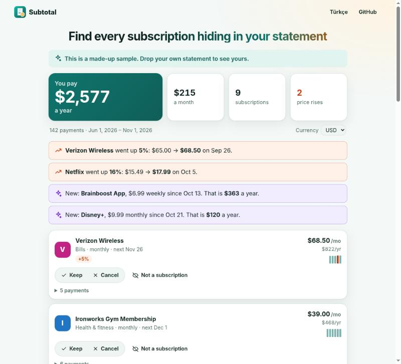
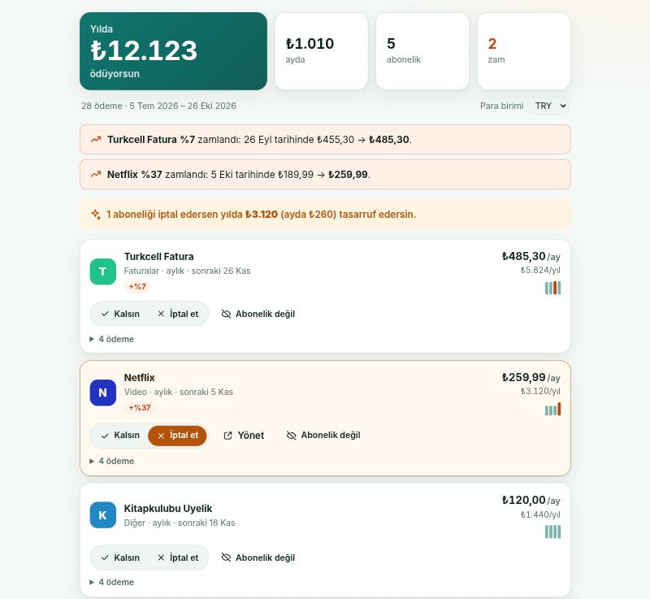

<p align="center">
  
</p>

<h1 align="center">Subtotal</h1>

<p align="center">
  <strong>Find every subscription hiding in your bank statement.</strong><br />
  Drop an Excel, CSV or PDF statement from any bank. See every subscription, every price rise and what they cost you a year.<br />
  Nothing is uploaded. No bank login. Works offline. No account, no ads, no tracking.
</p>

<p align="center">
  <a href="https://lxaedith.github.io/subtotal/"><strong>Try it live</strong></a> ·
  <a href="README.tr.md">Türkçe</a> ·
  <a href="docs/RESEARCH.md">Why this exists</a> ·
  <a href="#run-it-yourself">Run it yourself</a>
</p>

<p align="center">
  
</p>

---

## The problem

- People underestimate what they pay for subscriptions by **$133 a month** on average, and 42 % still pay for something they stopped using ([C+R Research](https://www.nbcwashington.com/news/business/money-report/consumers-spend-an-average-133-more-each-month-on-subscriptions-than-they-realize-study-shows/3067565/)).
- Prices creep up quietly. In Turkey, Netflix raised prices twice in 2026, the second time from 189.99 to 259.99 TL ([Gazete Oksijen](https://gazeteoksijen.com/ekonomi/netflix-turkiye-abonelik-ucretlerine-zam-yapti-iste-yeni-fiyatlar-291569)).
- Free trials turn into weekly charges that people only discover months later ([real complaints](docs/RESEARCH.md#the-problem)).

The tools that find subscriptions automatically want **your bank login** (through Plaid, US/UK/EU only) or want you to **upload your whole statement** to their server. Subtotal does the same job on your own device. Read the [research](docs/RESEARCH.md) behind it.

## Features

| | |
| --- | --- |
| **Any bank, any format** | Excel (.xlsx and old .xls), CSV in any delimiter and encoding (UTF-8, UTF-16, Windows-1254), PDF statements, HTML tables saved as .xls, or text pasted from online banking. Finds the date, description and amount columns itself; asks you only if it can't. |
| **Finds what repeats** | Groups payments by merchant (ignoring reference codes like `SPOTIFY P1B2C3`), then looks for a weekly, two-weekly, monthly, quarterly, half-yearly or yearly rhythm with a steady amount. Two subscriptions billed by the same store (Apple, Google) are told apart by amount. |
| **Knows 60+ services** | Netflix, Spotify, YouTube Premium, iCloud, ChatGPT, Disney+, Exxen, BluTV/HBO Max, TOD and more are recognised from a single charge, so even one month's statement is useful. |
| **Price rises** | "Netflix went up 37 %: ₺189.99 → ₺259.99 on 5 Oct." Foreign-currency billing that moves a little every month is marked "amount varies" instead. |
| **New and forgotten** | Flags subscriptions that started recently (the trial that turned paid), and lists the ones that stopped (so you can check a cancellation worked). |
| **Decide** | Mark each one *keep* or *cancel* and see what cancelling saves a year. Direct "manage" links for the big services. |
| **Reminders in your own calendar** | One `.ics` file with every renewal, two days' notice, or a "cancel before it renews" reminder. |
| **Next month** | Optionally remembers past payments on your device, so next month you just drop the new statement and see what changed. One button wipes it. |

Plus: multiple files at once (several months, cards or banks), currency picker, English and Turkish, light and dark mode, installable as an app.

<p align="center">
  
</p>

## Private by design, and you can check it

- **No server.** Subtotal is a static site. Your statement is read by JavaScript in your browser tab and never sent anywhere.
- **Enforced by the browser.** Production builds ship a strict [Content-Security-Policy](vite.config.ts) with `connect-src 'self'`. Even if a dependency tried to upload something, the browser would refuse. Open DevTools and see for yourself.
- **No bank login.** You download the statement yourself; Subtotal never sees a password. If your bank locks emailed PDFs with a password, it is used only to open the file in your browser.
- **Remembering is opt-in.** Only the outgoing payments (date, description, amount) are kept, in your browser's local storage, and "Forget everything" deletes them.
- **Works offline.** After the first visit everything is cached by a service worker.

## How it works

- **Reading** ([`src/readers/`](src/readers)): file type is sniffed from the bytes, not the name. Spreadsheets go through [SheetJS](https://sheetjs.com/), PDFs through [pdf.js](https://mozilla.github.io/pdf.js/) (text pieces on the same baseline are joined into lines), everything else is decoded and parsed as CSV.
- **Columns** ([`src/lib/table.ts`](src/lib/table.ts)): the header row is found by its words in English and Turkish ("İşlem Tarihi", "Açıklama", "Tutar", "Borç/Alacak", "Paid out"…), with a content-based fallback. Decimal separators and day/month order are decided per column (`1.234,56` vs `1,234.56`, `05/10` vs `10/05`). Whether money out is positive or negative is taken from the majority sign.
- **Detection** ([`src/lib/detect.ts`](src/lib/detect.ts)): each merchant's payments are tested against each schedule with a tolerance (billing dates drift) and allowing a missing month. Unknown merchants also need a steady amount, which is what keeps groceries and fuel out. Price changes are steps that persist, not one-off blips.
- The first load is about 25 KB gzipped. SheetJS and pdf.js load only when a spreadsheet or PDF is opened.

## Run it yourself

You need [Node.js](https://nodejs.org/) 20.19 or newer.

```bash
git clone https://github.com/LXAedith/subtotal.git
cd subtotal
npm install
npm run dev        # http://localhost:5173
```

```bash
npm test           # unit tests (Vitest)
npm run build      # type-check and production build into dist/
npm run preview    # serve the production build, CSP and offline mode included
```

SheetJS is installed from [`vendor/`](vendor), the tarball [SheetJS publishes on its own CDN](https://docs.sheetjs.com/docs/getting-started/installation/frameworks) (npm only has an outdated version).

### Deploy to GitHub Pages (free)

Every push to `main` runs the tests, builds and publishes to GitHub Pages ([workflow](.github/workflows/deploy.yml)). In a fork, set **Settings → Pages → Source** to **GitHub Actions** and point `REPO_URL` and `SITE_URL` in [`src/config.ts`](src/config.ts) at your copy.

## Project structure

```
src/
  main.ts          UI: drop zone, results, decisions, calendar export, memory
  i18n.ts          English and Turkish texts
  readers/         file sniffing, spreadsheets (SheetJS), PDF (pdf.js)
  lib/             CSV, amounts, dates, column finding, merchants, detection, calendar, history
  sw-template.js   offline service worker (file list is filled in at build time)
tests/             unit tests for the pure logic
```

## Roadmap

- [ ] More known services and local ones (contributions welcome: [`src/lib/merchants.ts`](src/lib/merchants.ts))
- [ ] OFX/QIF and MT940 exports
- [ ] Optional per-category budget view
- [ ] More languages, see [`src/i18n.ts`](src/i18n.ts)

## Contributing

Issues and pull requests are welcome. A statement format that isn't read correctly is the most useful report: please describe the column layout and number/date format, and **never attach a real statement**. Run `npm test` and `npm run build` before opening a PR.

## License

[MIT](LICENSE). Third-party parts: SheetJS Community Edition (Apache-2.0) and pdf.js (Apache-2.0), both loaded only when needed.
