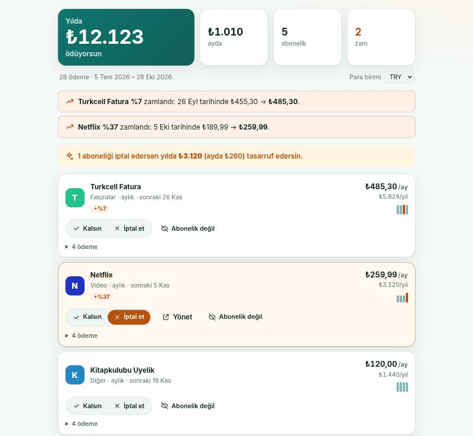

<p align="center">
  
</p>

<h1 align="center">Subtotal</h1>

<p align="center">
  <strong>Ekstrende gizlenen tüm abonelikleri bul.</strong><br />
  Herhangi bir bankanın Excel, CSV veya PDF ekstresini bırak. Tüm abonelikleri, her zammı ve yıllık maliyetlerini gör.<br />
  Hiçbir şey yüklenmez. Banka girişi yok. İnternetsiz çalışır. Üyelik, reklam ve takip yok.
</p>

<p align="center">
  <a href="https://lxaedith.github.io/subtotal/"><strong>Hemen dene</strong></a> ·
  <a href="README.md">English</a> ·
  <a href="docs/ARASTIRMA.md">Neden var?</a> ·
  <a href="#kendin-çalıştır">Kendin çalıştır</a>
</p>

<p align="center">
  
</p>

---

## Sorun

- İnsanlar abonelik harcamalarını ayda ortalama **133 $** eksik tahmin ediyor; %42'si kullanmayı bıraktığı bir hizmete hâlâ ödeme yapıyor ([C+R Research](https://www.nbcwashington.com/news/business/money-report/consumers-spend-an-average-133-more-each-month-on-subscriptions-than-they-realize-study-shows/3067565/)).
- Fiyatlar sessizce artıyor. Netflix Türkiye 2026'da iki kez zam yaptı; ikincisinde Temel paket 189,99 TL'den 259,99 TL'ye çıktı ([Gazete Oksijen](https://gazeteoksijen.com/ekonomi/netflix-turkiye-abonelik-ucretlerine-zam-yapti-iste-yeni-fiyatlar-291569)).
- Ücretsiz denemeler haftalık çekimlere dönüşüyor ve insanlar bunu aylar sonra fark ediyor ([gerçek şikâyetler](docs/ARASTIRMA.md#sorun)).

Abonelikleri otomatik bulan araçlar ya **banka girişini** istiyor (Plaid üzerinden, yalnızca ABD/İngiltere/AB; Türk bankalarıyla çalışmıyor) ya da **ekstrenin tamamını** kendi sunucularına yüklemeni istiyor. Subtotal aynı işi senin cihazında yapar. Arkasındaki [araştırmayı oku](docs/ARASTIRMA.md).

## Özellikler

| | |
| --- | --- |
| **Her banka, her biçim** | Excel (.xlsx ve eski .xls), her ayraç ve kodlamada CSV (UTF-8, UTF-16, Windows-1254), PDF ekstre, .xls olarak kaydedilmiş HTML tablolar ya da internet şubesinden yapıştırılan metin. Tarih, açıklama ve tutar sütunlarını kendisi bulur; bulamazsa sana sorar. |
| **Tekrarlayanı bulur** | Ödemeleri firmaya göre gruplar (`SPOTIFY P1B2C3` gibi referans kodlarını yok sayar), sonra sabit tutarlı haftalık, iki haftalık, aylık, üç aylık, altı aylık ya da yıllık bir düzen arar. Aynı mağazadan (Apple, Google) faturalanan iki abonelik tutarına göre ayrılır. |
| **60'tan fazla servisi tanır** | Netflix, Spotify, YouTube Premium, iCloud, ChatGPT, Disney+, Exxen, BluTV/HBO Max, TOD ve diğerleri tek bir çekimden tanınır; tek aylık ekstre bile işe yarar. |
| **Zamlar** | "Netflix %37 zamlandı: 5 Eki tarihinde ₺189,99 → ₺259,99." Her ay biraz değişen döviz bazlı ödemeler zam olarak değil, "tutar değişken" olarak işaretlenir. |
| **Yeni ve unutulan** | Yeni başlayan abonelikleri (ücretliye dönen denemeyi) işaretler, artık çekilmeyenleri de listeler (iptalin gerçekten işlediğini kontrol edebilirsin). |
| **Karar ver** | Her birini *kalsın* ya da *iptal et* olarak işaretle, iptalin yılda ne kazandıracağını gör. Büyük servisler için doğrudan "yönet" bağlantıları var. |
| **Hatırlatıcılar kendi takviminde** | Tüm yenilemeleri iki gün önceden hatırlatan ya da "yenilenmeden iptal et" diyen tek bir `.ics` dosyası. |
| **Gelecek ay** | İstersen geçmiş ödemeleri cihazında hatırlar; gelecek ay sadece yeni ekstreyi bırakıp neyin değiştiğini görürsün. Tek tuşla silinir. |

Ayrıca: birden fazla dosya birden (birkaç ay, kart ya da banka), para birimi seçimi, Türkçe ve İngilizce, açık ve koyu tema, uygulama olarak yüklenebilme.

## Gizlilik tasarımın parçası ve kontrol edebilirsin

- **Sunucu yok.** Subtotal statik bir sitedir. Ekstren tarayıcı sekmendeki JavaScript tarafından okunur ve hiçbir yere gönderilmez.
- **Tarayıcı tarafından zorunlu kılınır.** Production derlemeleri `connect-src 'self'` içeren sıkı bir [içerik güvenlik politikasıyla](vite.config.ts) gelir. Bir bağımlılık bir şey yüklemeye çalışsa bile tarayıcı reddeder. Geliştirici araçlarını açıp kendin bak.
- **Banka girişi yok.** Ekstreyi kendin indirirsin; Subtotal hiçbir parola görmez. Bankan e-postayla gelen PDF'leri parolayla kilitliyorsa, parola yalnızca dosyayı tarayıcında açmak için kullanılır.
- **Hatırlama isteğe bağlı.** Yalnızca giden ödemeler (tarih, açıklama, tutar) tarayıcının yerel deposunda tutulur; "Her şeyi unut" hepsini siler.
- **İnternetsiz çalışır.** İlk ziyaretten sonra her şey bir service worker tarafından önbelleğe alınır.

## Nasıl çalışır?

- **Okuma** ([`src/readers/`](src/readers)): dosya türü adından değil baytlarından anlaşılır. Tablolar [SheetJS](https://sheetjs.com/) ile, PDF'ler [pdf.js](https://mozilla.github.io/pdf.js/) ile okunur (aynı satır hizasındaki metin parçaları birleştirilir); geri kalan her şey çözülüp CSV olarak ayrıştırılır.
- **Sütunlar** ([`src/lib/table.ts`](src/lib/table.ts)): başlık satırı Türkçe ve İngilizce sözcüklerinden bulunur ("İşlem Tarihi", "Açıklama", "Tutar", "Borç/Alacak", "Paid out"…); bulunamazsa içeriğe bakılır. Ondalık ayracı ve gün/ay sırası her sütun için ayrı belirlenir (`1.234,56` ile `1,234.56`, `05/10` ile `10/05`). Giden paranın artı mı eksi mi yazıldığı çoğunluktaki işaretten anlaşılır.
- **Bulma** ([`src/lib/detect.ts`](src/lib/detect.ts)): her firmanın ödemeleri her düzene göre bir toleransla (fatura tarihleri kayar) ve bir ayın eksik olmasına izin vererek denenir. Tanınmayan firmalarda tutarın da sabit olması gerekir; marketi ve akaryakıtı dışarıda tutan budur. Zam, kalıcı bir basamaktır; tek seferlik sapmalar sayılmaz.
- İlk yükleme yaklaşık 25 KB (gzip). SheetJS ve pdf.js yalnızca bir tablo ya da PDF açıldığında yüklenir.

## Kendin çalıştır

[Node.js](https://nodejs.org/) 20.19 veya daha yenisi gerekir.

```bash
git clone https://github.com/LXAedith/subtotal.git
cd subtotal
npm install
npm run dev        # http://localhost:5173
```

```bash
npm test           # birim testleri (Vitest)
npm run build      # tip kontrolü ve dist/ içine production derlemesi
npm run preview    # production derlemesini CSP ve çevrimdışı modla birlikte sun
```

SheetJS, [kendi CDN'inde yayımladığı](https://docs.sheetjs.com/docs/getting-started/installation/frameworks) paketle [`vendor/`](vendor) klasöründen kurulur (npm'deki sürümü eski).

### GitHub Pages'e yayınla (ücretsiz)

`main` dalına yapılan her push testleri çalıştırır, derler ve GitHub Pages'e yayınlar ([iş akışı](.github/workflows/deploy.yml)). Bir fork'ta **Settings → Pages → Source** ayarını **GitHub Actions** yap ve [`src/config.ts`](src/config.ts) içindeki `REPO_URL` ile `SITE_URL` değerlerini kendi kopyana yönlendir.

## Yol haritası

- [ ] Daha fazla bilinen ve yerel servis (katkılara açık: [`src/lib/merchants.ts`](src/lib/merchants.ts))
- [ ] OFX/QIF ve MT940 dışa aktarımları
- [ ] İsteğe bağlı kategori bütçe görünümü
- [ ] Daha fazla dil, bkz. [`src/i18n.ts`](src/i18n.ts)

## Katkı

Issue ve pull request'ler memnuniyetle karşılanır. En faydalı bildirim, doğru okunamayan bir ekstre biçimidir: lütfen sütun düzenini ve sayı/tarih biçimini anlat, **asla gerçek bir ekstre ekleme**. PR açmadan önce `npm test` ve `npm run build` çalıştır.

## Lisans

[MIT](LICENSE). Üçüncü taraf parçalar: SheetJS Community Edition (Apache-2.0) ve pdf.js (Apache-2.0); ikisi de yalnızca gerektiğinde yüklenir.
